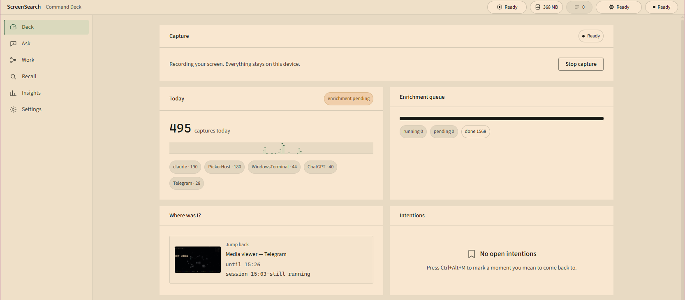
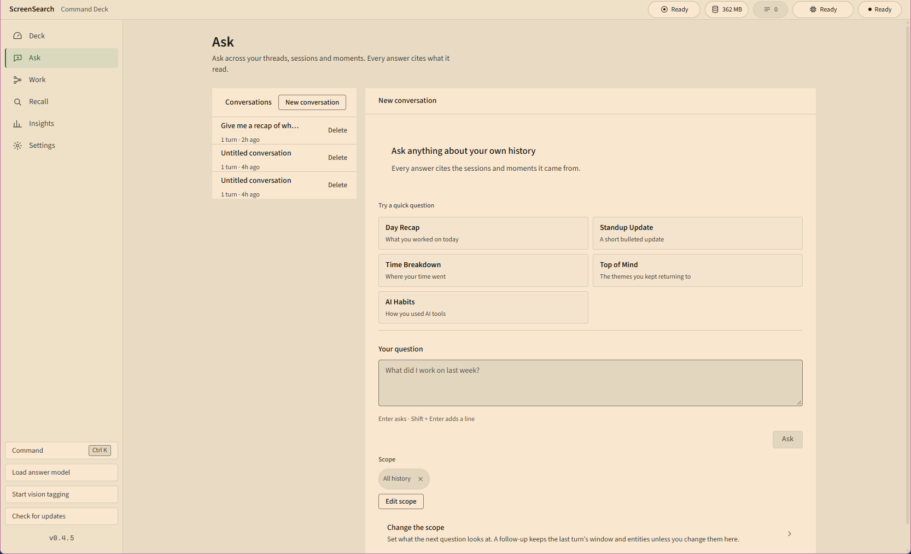
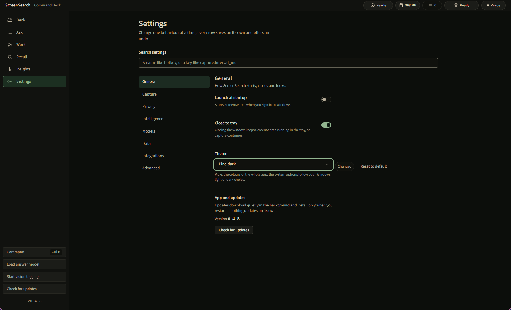

# ScreenSearch

A local-first **Windows** desktop app that continuously captures your screen, makes it
searchable by **text and meaning**, and answers questions about what you've seen — fully
on-device. Optional Telegram digests send selected report text to a configured conversation;
capture storage and inference remain local.

**It's also memory your agents can query.** Where most screen-recall tools stop at a search box for
you, ScreenSearch exposes your screen history through an opt-in local **MCP server**
(`screensearch-mcp`) — so Claude Desktop, Claude Code, or any MCP client can search your captures,
ask grounded questions with cited frames, and, as of v0.4.0, reason over automatically segmented
**work sessions** (`list_sessions`, `get_session`, `ask_session`). As of v0.4.2, agents can also
page through history chronologically, check capture coverage and read saved daily/weekly
reports (`list_frames`, `get_capture_coverage`, `list_reports`, `get_report`). As of v0.4.5 they
can read the work graph and the derived insights as well (`list_threads`, `get_thread`,
`find_connections`, `list_insights`); the wrapper ships **seventeen tools**, fourteen of them
with `--read-only`. Every answer is drawn from the local database. The MCP wrapper uses
loopback by default and accepts an explicitly configured remote HTTP/HTTPS API root. The
HTTP API defaults to `127.0.0.1`;
explicit network binding lets authenticated reachable devices read history. Plain HTTP exposes
tokens/history to network observers. Inference stays on-device.

Active source repository: [github.com/nicolasestrem/screensearch](https://github.com/nicolasestrem/screensearch).

> **Status - v0.4.5 shipped (2026-11-07).** The full app is live: capture → OCR/UIA text →
> deferred enrichment → **hybrid search**, a supervised out-of-process **llama.cpp inference
> sidecar** (Job-Object-bound) for vision tagging and grounded streaming answers, and a shell
> whose rail is **Deck, Ask, Work, Recall, Insights, Settings** on one token set with four
> themes - Pine and Ink, each in light and dark, each with a follow-the-system choice. **Work**,
> **Thread** and **Ask** are their own routes (`/work`, `/work/:id`, `/ask`), and the app keeps
> its global-hotkey **Flow overlay**, an opt-in **local HTTP API + MCP server**, **auto-update**
> and a native **system tray**. Captured frames are grouped into **sessions** with a pure
> on-device heuristic, sessions are clustered into **threads** by the work graph, and history
> becomes daily and weekly **memory reports** that agents can read. **Authenticode
> code-signing** is the one remaining packaging follow-up - until then the NSIS installer is
> unsigned and SmartScreen warns ("More info →
> Run anyway"). **v0.4.5 requires a fresh database**: there is no migration chain, and a database
> at any other schema version is refused with a message that names the dev-only `ssv2c-rebuild`
> tool. Full release history is in
> [`CHANGELOG.md`](./CHANGELOG.md) / [`CHANGELOG-ARCHIVE.md`](./CHANGELOG-ARCHIVE.md); the
> design lives in [`specs/`](./specs) and the as-built architecture in
> [`docs/ARCHITECTURE.md`](./docs/ARCHITECTURE.md). A standalone, clean-slate project - it
> shares no code or data with any prior version.

## New in v0.4.5 - work graph, Ask v2, insights and the Logbook design

These additions shipped in v0.4.5 (2026-11-07) and reach you through auto-update: your saved
sessions now cluster into threads you can open, ask about and check the evidence for, and the whole
app is redrawn on one design system - but a 0.4.5 database is created fresh, so read **Before you
install** below before you upgrade.

| Feature | What you can do |
|---|---|
| **Work and threads** | `/work` lists the threads the clusterer derived from repositories, file paths, domains, documents, references and apps, ordered by **Last touched** or **Time spent** and filterable by entity. `/work/:id` opens one thread: its session timeline, the entities those sessions touched, the open loops it still holds (each with the evidence that raised it), the threads it connects to, and an Ask scoped to it. Rename, merge and split are written as overrides to `thread_overrides` and applied by the clusterer afterwards, so your edit keeps beating the automatic grouping. |
| **Ask v2** | Ask plans the turn before it retrieves: calendar phrasing ("this morning", "last Tuesday", "the week before") becomes an explicit window in your local timezone, and an entity mention scopes retrieval through the work graph. Retrieval then narrows in one fixed order - threads, then sessions (ten at most), then frames - and every answer cites both the frames it read and the sessions they belong to. Conversations are saved, so a follow-up reuses the previous turn's window and scope, with a chip saying it inherited them. |
| **Insights** | Five kinds of claim over a window: `thread_activity`, `open_loop`, `recurrence`, `semantic_neighbour`, `resumption`. Each is a typed row that renders without a model call and carries at least one evidence reference by construction; a row whose evidence has since gone is labeled **May be out of date** instead of being asserted as current, and a window still being computed says how many passes are left. Generation is one job under the idle gate and never runs on the capture path - a read never generates. |
| **Logbook design and four themes** | Every screen is drawn on one token set under the **Logbook** identity: four themes - Pine and Ink, each in light and dark - with a follow-the-system choice for each, bundled local fonts (Source Sans 3, Cascadia Mono), and every screen rebuilt on the v2 primitives. The v1 token shim is deleted, and a token test plus a lint rule keep it gone. |
| **Settings v2** | Eight categories (General, Capture, Privacy, Intelligence, Models, Data, Integrations, Advanced) over 26 settings with one row pattern. Every row saves on its own and offers Undo from a toast; there is no global Save button. Search matches a row's label, its dotted key, its field name and its help text. Destructive actions ask first and name the consequence. |
| **Timeline, Session and Moment** | Rebuilt on v2. The timeline's scan-head is replaced by a density ribbon whose bar heights are the real capture counts, with four reserved lanes for session bands. Session and Moment show entity chips and a connections panel, fed by one additive read (`get_session_graph`); a session that was never clustered shows an empty arm rather than an error. |
| **Performance** | Initial JavaScript is 112.9 KB gzip in the main window and 75.4 KB in the overlay window - 45% and 30% of the 250 KB budget - and every route is its own chunk, none of them in the eager set. |
| **Before you install** | 0.4.5 needs a fresh database: there is no migration chain, and an older file is refused untouched with a message naming the dev-only `ssv2c-rebuild` tool, which carries a v13 history into the new v15 baseline read-only (its bytes and modification time are left unchanged). A fresh install starts from default settings. The HTTP API and MCP surfaces gained additive reads only: `GET /v1/threads`, `GET /v1/threads/{id}`, `GET /v1/entities`, `GET /v1/insights`, and the four MCP tools `list_threads`, `get_thread`, `find_connections`, `list_insights`. |

See the [0.4.5 arc record](docs/0.4.5.md), the [HTTP API guide](docs/API.md) for the four graph
and insight reads, and the [MCP guide](docs/MCP.md#tools) for the tool table.

## Memory and agent reads (v0.4.2)

Build cross-day memory on top of your saved daily reports, and let your own agents read it.
These additions shipped in v0.4.2 and reach existing installs through auto-update. The first
launch upgrades the database one way (schema 12 → 13); back up your data folder first if you
may want to return to v0.4.1.

| Addition | What you can do |
|---|---|
| **Weekly synthesis** | Summarize one complete ISO week from that week's saved daily reports (never a fresh scan of raw captures). Statuses stay truthful: `NO_DATA`, `PARTIAL` with the missing dates named, `OK` only with complete daily coverage, `BLOCKED` or `FAILED`. |
| **Weekly notes** | Weekly notes land in `ScreenSearch/Weekly/YYYY-Www.md` and in `Index.md`, linked to the daily notes they consumed. Edited notes are preserved as conflicts. |
| **Weekly schedule** | Off by default, with its own time and timezone. **Run most recent complete week** works while it is off; restart catch-up covers the four most recent due weeks, and older or failed weeks are listed as missed. |
| **Project note promotion** | Pick decisions, open questions, next steps or activity from a saved report and, after you confirm a preview, append them with provenance to one project note you created under `ScreenSearch/Projects/`. |
| **Weekly Telegram digest** | Opt in separately (off by default; the daily consent never covers it) to a digest of the saved weekly synthesis. No second model runs. |
| **Agent memory reads** | Opt-in HTTP API reads for chronological frame pages (`GET /v1/frames`), capture coverage (`GET /v1/coverage`) and saved reports (`GET /v1/reports`). Reads never generate, retry or deliver a report. |
| **Read-only API token** | Create an independent token in **Settings → HTTP API** that can read history but is refused for marks writes, capture requests and Ask. |
| **Remote-capable MCP wrapper** | The bundled `screensearch-mcp.exe` adds four read tools and accepts an explicit remote HTTP/HTTPS API root (`--api-url`); it ignores proxies, refuses redirects and verifies certificates. |

Weekly scheduling and the weekly Telegram digest are configured in **Settings → Memory reports**
and both start **off**. Promotion has no HTTP or MCP surface. MCP `--read-only` only filters
tools and is **not authorization** — use the read-only token for server-enforced permissions.
Coverage counts describe stored records; capture intent, empty windows and frame gaps are not
proof of capture health, inactivity or complete memory. Frame-identity protection covers
future reuse, not old binaries, clones or restores; known restores need explicit client
reconciliation. The weekly features have automated and Windows CI/native test-chain coverage;
a native interactive acceptance run (a real week in the installed app, Obsidian inspection, a
promotion) is still pending.

See the [Memory reports guide](docs/MEMORY.md#weekly-synthesis), the
[HTTP API guide](docs/API.md#chronological-frames), the [MCP guide](docs/MCP.md#configuration)
and the runnable [checkpoint consumer](docs/MEMORY_CONSUMER.md).

## Memory reports (v0.4.1)

Turn captured activity into notes you can revisit in **Obsidian**, with an optional digest in
**Telegram**. Generate a report when you need it, or set a daily schedule. Capture storage and
AI inference stay on your Windows computer.

These additions shipped in v0.4.1 and reach existing installs through auto-update.

| Addition | What you can do |
|---|---|
| **Pick a date or range** | Report on one day or an inclusive range of dates. Include today for an explicitly partial report up to the time you start it. |
| **Schedule daily reports** | Choose a time in hours and minutes and a fixed timezone. The scheduler handles daylight-saving changes and catches up on up to seven missed days. |
| **Keep notes in Obsidian** | Choose a folder for Markdown notes and a linked index. Selected-date reports stay separate from scheduled daily notes; edited or unrelated files are preserved. |
| **Receive Telegram digests** | Opt in to a text digest of the saved report, sent to your chosen conversation. Bot tokens stay in Windows Credential Manager; selected digest text leaves the device. |
| **See coverage and delivery status** | Inspect the captured sources, partial coverage and separate note/Telegram receipts. Retry delivery without regenerating, or create a new report revision. Empty windows are labeled `NO_DATA` and skip Telegram. |
| **Choose the API bind address** | Keep the default `127.0.0.1`, choose another IPv4/IPv6 address, or explicitly select a wildcard for network access. Existing enabled installations retain loopback when no address is configured. |

To get started, open **Settings → Memory reports**, choose a timezone
and output folder, then select dates under **Run a report**. Daily scheduling and Telegram are
independent options and both start **off**. Reports use an already installed local answer model;
they do not download one automatically.

Scheduled notes live in `ScreenSearch/Daily/`; selected-date reports live in `ScreenSearch/Reports/`.
Both are linked from `ScreenSearch/Index.md` inside your chosen folder.

See the [Memory reports guide](docs/MEMORY.md) for setup, scheduling and recovery, or the
[HTTP API guide](docs/API.md) for binding, authentication and the plain-HTTP network boundary.

## Screenshots

The **Logbook** interface: Deck, Ask, Work, Recall, Insights and Settings, in four themes (Pine and
Ink, each light and dark). Capture, storage and inference run on-device. The optional HTTP API
exposes history to authenticated clients; see its [network boundary](docs/API.md).



> **Deck**: the at-a-glance home. Capture status, today's captures and top apps, the enrichment
> queue, where you were before the last detour, and your open intentions (marks).



> **Ask**: questions about your own history. It plans the time window and scope first, cites the
> sessions and moments it read, and keeps the conversation so a follow-up inherits its scope.



> **Settings**: eight categories, a search over every setting by name or key, and autosave with
> undo on each row. Shown here in Pine dark.

> **Note:** captured from a real install on the maintainer's machine. The only captured content
> visible is app names and one small thumbnail on the Deck.

## What it does

- **Always-on, cheap capture.** Windows.Graphics.Capture writes changed frames straight to a local
  SQLite store, behind diff and privacy gates. Capture runs on a timer by default, with opt-in
  event-driven triggers (foreground + idle). Each frame is archived as lossless WebP.
- **On-device text extraction.** Foreground-window text via **UI Automation**, falling back to
  native **WinRT OCR**, then an **attention-first filter** that keeps content text over chrome
  (raw text stays available opt-in).
- **Deferred, user-controlled enrichment.** Embeddings run as durable jobs in a SQLite-backed
  queue drained by a bounded worker pool; **vision tagging is on-demand / timed / idle only** —
  never real-time. An optional CPU/GPU pressure throttle eases off background work under load
  without ever pausing capture, OCR, or storage.
- **Hybrid search.** FTS5 keyword + sqlite-vec semantic, fused with Reciprocal Rank Fusion —
  **~33 ms p95 on a 10 000-frame database**. Embeddings are EmbeddingGemma-300M (768-dim) via
  **fastembed** (in-process ONNX).
- **Grounded answers & reports.** RAG over your screen history through the local **llama.cpp
  sidecar**: streaming answers with cited frames, and Daily / Weekly / Custom **Recall reports**
  that cite the frames they used. Vision tagging emits structured output with an honest confidence,
  never a fabricated score.
- **Memory reports.** Save reports for selected dates or on a daily schedule, synthesize each
  complete week from the saved dailies, browse them as Markdown notes in Obsidian, promote
  confirmed items into one project note, and optionally receive daily and weekly Telegram digests.
  Coverage and delivery receipts make empty windows, partial reports and failed attempts visible.
- **Sessions.** A pure on-device heuristic groups frames into focus, meeting, and concurrent
  AI-tool sessions — additively, with no model calls and no change to frame-level behavior.
  Sessions surface in the Timeline, the local API, and MCP.
- **Fast recall overlay.** `Ctrl+Alt+Z` opens the **Flow overlay** — a second, capture-protected
  Tauri window for quick Search/Ask without leaving your foreground app. `Esc` hides it; `Enter`
  opens the selected Moment in the main Command Deck. `Ctrl+Alt+M` marks the current moment.
- **HTTP API + local MCP.** An opt-in HTTP API (off by default, bearer authenticated) with
  configurable IPv4/IPv6 binding (loopback by default) exposes search / ask / frames / marks /
  sessions, chronological frame pages, capture coverage, saved reports, the work graph and the
  derived insights, and JSON export to reachable scripts and agents, with an optional independent
  read-only token. Plain HTTP is not encrypted; enable only with appropriate network access
  restrictions. `screensearch-mcp.exe` — bundled in the installer — wraps it as a stdio **MCP
  server** for Claude Desktop / Claude Code, loopback by default or pointed at an explicit remote
  HTTP/HTTPS API root (see [`docs/API.md`](docs/API.md), [`docs/MCP.md`](docs/MCP.md)).
- **Lives in the tray, updates itself.** A native system tray with a passive capture-state icon
  and quick actions keeps capture running when you close the window (a one-time toast explains it;
  run-at-startup is off by default). From v0.3.2 on the app auto-updates: a signed manifest is
  checked at launch, the new installer downloads in the background, and it installs only when you
  choose to restart — no modal, no nag.

## Build progress

| Phase | Scope | Status |
|---|---|---|
| **P0** | Scaffold — Cargo workspace, `traits` contracts, Tauri 2 shell, React/TS UI, `ts-rs` IPC, CI, `doctor` | ✅ Complete |
| **P1** | Data spine — SQLite (WAL) + FTS5 + sqlite-vec, forward-only migrations, durable job queue, hybrid search | ✅ Complete |
| **P2** | Capture happy path — WGC capture + diff/privacy gates, WinRT OCR, kernel event bus, live timeline | ✅ Complete |
| **P3** | Deferred enrichment — fastembed embedding worker pool, vector arm, `search` command, perf-verified | ✅ Complete |
| **P4** | Inference sidecar — llama.cpp (Job-Object-bound, no-orphan), vision tagging, grounded streaming `ask` | ✅ Complete |
| **P5** | Command-Deck UI (Deck, Recall, Timeline, Moment, Insights, Settings) + typed IPC | ✅ Feature-complete; live-verified |
| **Pkg** | Unsigned **NSIS** installer shipped; **Authenticode code-signing** is the lone follow-up (DoD §13.9, `07` #26) | 🚧 Signing pending |

Post-v1.0 arcs — attention-first text (0.2.x), surface reduction + flow recall + local API (0.3.0),
the product shell (auto-update, tray, two-tier Settings — 0.3.2), the sessions reframe (0.4.0),
memory reports + configurable API bind (0.4.1), weekly memory + agent memory reads (0.4.2), and the
work graph, Ask v2 and Logbook rebuild (0.4.5) —
have all shipped. Each arc's detailed record lives in its `docs/<version>.md` and in
[`CHANGELOG-ARCHIVE.md`](./CHANGELOG-ARCHIVE.md); point-in-time PR audits live as local-only
artifacts under `docs/audits/` (git-ignored, not pushed).

## Architecture (summary)

- **Shell:** Tauri 2 + WebView2; React 18 + TypeScript UI; typed IPC via `ts-rs`; a main Command
  Deck window plus a pre-created protected Flow overlay summoned by a global shortcut.
- **Core:** a modular Rust **kernel** — trait-bounded modules over a typed event bus; `src-tauri`
  is the composition root that wires the concrete impls in.
- **Processing:** *capture-cheap, enrich-deferred* — a durable SQLite **job queue** drained by a
  bounded worker pool (retry/backoff, dead-lettering, stale-job recovery). An optional CPU/GPU
  pressure throttle reduces background enrichment under load; capture/OCR/storage never pause.
- **Text source:** foreground-window text via **UI Automation** with automatic fallback to native
  **WinRT OCR**, then an attention-first filter that keeps content over chrome.
- **Data:** SQLite (WAL) + FTS5 + sqlite-vec (768-dim, cosine); one baseline schema at version 15
  with no migration chain (a database at any other version is refused; the dev-only
  `ssv2c-rebuild` tool carries a v13 history into the new file).
- **Embeddings:** **fastembed** (in-process ONNX) — EmbeddingGemma-300M text. **No Python in the
  runtime.**
- **Inference:** a single supervised, model-agnostic **llama.cpp sidecar** (Vulkan GPU + CPU
  fallback), **bound to the app via a Windows Job Object** so it can never orphan after a crash;
  advanced users can list/select llama.cpp devices when the default Vulkan device is wrong.

See [`docs/ARCHITECTURE.md`](./docs/ARCHITECTURE.md) for the as-built design and data flow.

### Models (user-selectable, 2 tiers per lane)

| Lane | Default | Quality |
|---|---|---|
| **Vision** | Qwen3-VL-4B-Instruct | Qwen3-VL-8B-Instruct |
| **Answer** | Ministral-3-3B-Reasoning-2512 | Qwen3-4B-Thinking-2507 |
| **Embeddings** | EmbeddingGemma-300M (text) | |

Exact HF repos / quants are pinned in [`specs/MODEL_REGISTRY.md`](./specs/MODEL_REGISTRY.md).
Embedding models auto-download on first use into `<app-data>/models/fastembed`. The llama.cpp
engine downloads at launch into `<app-data>/sidecar/llama`, and vision/answer models on first use.
While anything is being prepared, a "Preparing local AI" chip in the status bar shows the stage
and real progress; a failure stays visible as "Setup failed", with details and the next step in
**Settings · Models**.

## Repository layout

```
CLAUDE.md          agent entry point (Claude Code) — mandatory reading order + hard rules
AGENTS.md          agent entry point (Codex) — same contract, Codex-flavored
README.md          this file
CHANGELOG.md       human-facing changelog (Keep a Changelog); older releases in CHANGELOG-ARCHIVE.md
Cargo.toml         Cargo workspace (centralized dependency versions)
docs/
  ARCHITECTURE.md          as-built system design + data flow
  API.md / MCP.md          local HTTP API + MCP server reference
  TESTING.md               test matrix and how to run the gated suites
  <version>.md             per-arc design + build records (0.2.0 … 0.4.5)
  audits/                  point-in-time PR audit evidence (local-only, git-ignored)
screenshots/       Logbook UI screenshots used by this README
crates/            18-crate Rust workspace (module crates depend on `traits` only):
  traits/          module contracts + shared domain/IPC/job types (no impls)
  kernel/          orchestrator: event bus, capture loop, worker pool, settings, resume heuristic
  store/           data spine: SQLite + sqlite-vec + FTS5, job queue, hybrid search
  capture/         CaptureSource (WGC) + diff/privacy gates + event-driven triggers
  ocr/             OcrProvider (WinRT Media.Ocr, STA worker)
  uia/             UI Automation foreground-window text source (OCR fallback)
  textfilter/      pure, deterministic span-aware text classifier (attention-first filtering)
  embeddings/      EmbeddingProvider (fastembed, in-process ONNX)
  inference/       VisionProvider + AnswerProvider + llama.cpp supervisor (Job-Object lifecycle)
  sysmon/          CPU/GPU pressure probe driving the enrichment throttle
  doctor/          WebView2 / Vulkan / llama-server environment smoke-check
  api/             opt-in HTTP API + JSON export (axum, configurable IP bind + bearer token)
  mcp/             screensearch-mcp.exe — stdio MCP wrapper over the local API
  sessions/        pure heuristic session segmentation + tool recognition (no model calls)
  graph/           work-graph engine: entity extraction, thread clustering, override precedence
  harness/         dev-only, read-only segmentation validation harness (not shipped in the app)
  rebuild/         dev-only v13 to v15 rebuild tool (`ssv2c-rebuild`); not shipped
  evalfixture/     dev-only eval fixture + local API host over seeded history; not shipped
src-tauri/         Tauri 2 shell + composition root + command handlers + main()
ui/                React 18 + TS + Vite — the shell and its ten screens (typed IPC)
specs/             spec-engineering pipeline (00 intake → 04 build prompt → 05–08 build/review)
                   + UI_REFERENCE.md   (frontend identity, tokens, screens, state matrix)
                   + MODEL_REGISTRY.md (exact HF repos / quants / mmproj per model tier)
```

## Build & run

Prerequisites: **Windows 10/11**, Rust **1.95** or newer (the repo pins **1.95.0** via rustup), Node.js 22 +
npm, and WebView2 (preinstalled on current Windows). First run downloads the embedding model
(~hundreds of MB) and an ONNX Runtime build at compile time.

```powershell
# 1. UI first — src-tauri's `generate_context!` embeds `ui/dist` (git-ignored), so the
#    Rust build fails if the UI hasn't been built yet. `npm run lint` is the Rules-of-Hooks gate.
cd ui && npm ci && npm run lint && npm run build && cd ..

# 2. Stage the MCP sidecar — src-tauri declares `screensearch-mcp.exe` as a `bundle.externalBin`
#    that `tauri-build` resolves on every compile, so a fresh clone must stage it once before any
#    cargo command (npm run dev / build do this automatically; a bare cargo build does not).
node scripts/stage-mcp.mjs

# 3. Rust workspace
cargo fmt --all -- --check
cargo clippy --workspace --all-targets -- -D warnings
cargo build --workspace
cargo test --workspace            # GPU/WinRT/model/perf tests are #[ignore]d

# 4. Binding guard — `cargo test` regenerates the ts-rs IPC bindings; they must stay clean
#    (commit the regenerated files, or CI fails).
git diff --exit-code -- ui/src/bindings

# Run the app only via the root npm script — never the debug executable or cargo tauri dev.
# The Tauri CLI ships as the npm dev-dependency `@tauri-apps/cli`.
npm run dev
```

Model-backed and hardware tests are gated behind `#[ignore]` (they download models or need a real
display/GPU). Run them locally:

```powershell
cargo test -p embeddings -- --ignored                       # loads the real EmbeddingGemma model
cargo test -p store --test perf -- --ignored --nocapture    # hybrid-search latency on 10k frames
cargo test -p ocr -- --ignored                              # WinRT OCR smoke (needs a language pack)
cargo test -p inference --test smoke -- --ignored --nocapture  # real llama-server: vision tag + grounded ask (GPU)
```

See [`docs/TESTING.md`](docs/TESTING.md) for the full test matrix.

## Environment check

```powershell
cargo run -p doctor            # WebView2 / Vulkan / llama-server readiness (diagnostic; add -- --json)
```

## Platform

The desktop app/capture/inference remain Windows 10/11 only (Windows-native capture, OCR,
WebView2). The approved exception is the standalone stdio HTTP-client wrapper, not a
cross-platform app rewrite. CI builds and runs packaged wrapper archives on Windows x86_64,
Linux x86_64 and macOS arm64, but only the Windows installer (which bundles
`screensearch-mcp.exe`) is published as a release asset; on other systems, build the wrapper
from source (see [`CLAUDE.md`](./CLAUDE.md) and [MCP](docs/MCP.md)).

## Inspirations & prior art

ScreenSearch stands on a small but real lineage of "record your screen, make it searchable"
projects. A few that shaped the thinking here, in different ways:

- [screenpipe](https://github.com/mediar-ai/screenpipe) — open-source, local-first continuous
  screen (and audio) capture with search; the closest kin to this project's goals.
- [Rewind.ai](https://www.rewind.ai/) — the macOS "perfect memory" app that popularized personal,
  on-device screen recall and natural-language questions over what you've seen.
- [Rem](https://github.com/jasonjmcghee/rem) — an open-source, local-first take on the same idea for
  macOS.
- [OpenRecall](https://github.com/openrecall/openrecall) — a privacy-first, cross-platform open
  alternative in the same space.

ScreenSearch's approach differs in a few key ways:

- **Windows-only by design** — native Windows APIs (capture, OCR, WebView2), no cross-platform
  abstractions.
- **Rust-only ML runtime** — fastembed and a local llama.cpp sidecar, with no cloud calls.
- **Heuristic sessions** — frames are grouped into sessions by a pure on-device heuristic rather
  than a model.

Everything runs on-device.

## License

[MIT](./LICENSE) © 2026 Nicolas Estrem
